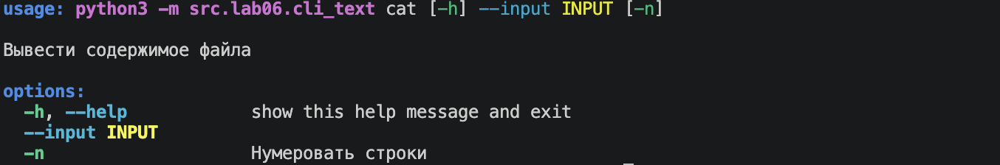
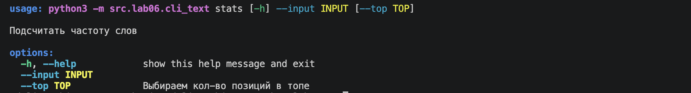
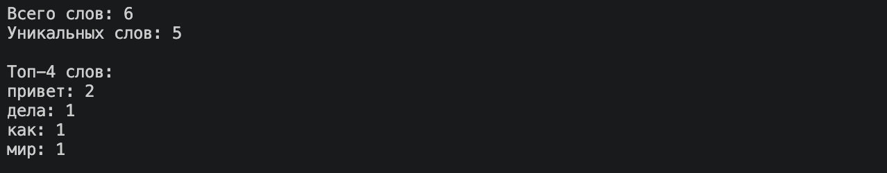
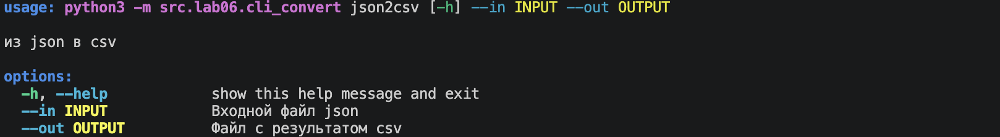
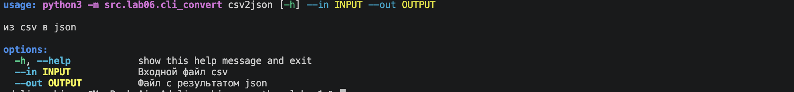
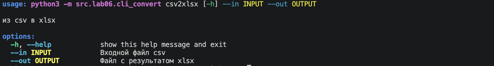

# Лабораторная работа 6 - CLI‑утилиты с argparse
## 1. CLI‑утилиты
### 1.1 Подкоманда cat

```bash
python3 -m src.lab06.cli_text cat --input data/samples/people.csv
```
Выводит текст построчно ↑
```bash
python3 -m src.lab06.cli_text cat --input data/samples/people.csv -n
```
Вывод текст построчно с номерами ↑

> Вывод подкоманды cat с --n
### 1.2 Подкоманда stats

```bash
python3 -m src.lab06.cli_text stats --input data/samples/people.txt
```
Запуск с количеством слов по умолчанию ↑

```bash
python3 -m src.lab06.cli_text stats --input data/samples/people.txt --top 4
```
Запуск с заданным количеством слов ↑

> Запуск программы с --top 4

## 2. CLI-конвертеры
### 2.1 Подкоманда json2csv

```bash
python3 -m src.lab06.cli_convert json2csv --in data/samples/people.json --out data/out/people_from_json.csv
```


### 2.2 Подкоманда csv2json

```bash
python3 -m src.lab06.cli_convert csv2json --in data/samples/people.csv --out data/out/people_from_csv.json
```

### 2.3 Подкоманда csv2xlsx

```bash
python3 -m src.lab06.cli_convert csv2xlsx --in data/samples/people.csv --out data/out/people_from_csv.xlsx
```