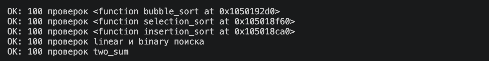
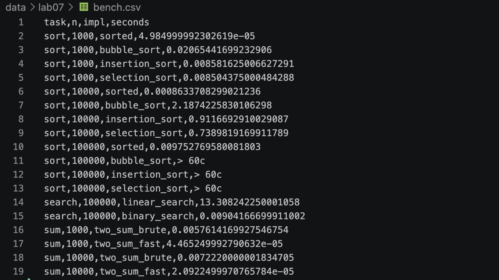

# Лабораторная работа 7 - Поиск, сортировка и измерение времени
## search.py - функции поиска
- linear_search(nums, x) - индекс первого вхождения или -1
> Пример: linear_search([4, 2, 7, 2], 2) -> 1 

- binary_search(sorted_nums, x) — индекс любого вхождения или -1
> Привет: binary_search([1, 3, 5, 7], 5) -> 2 

- two_sum_brute(nums, target) — пара индексов (i, j) таких что ums[i] + nums[j] == target <br>
- two_sum_fast(nums, target) — то же через словарь за один проход
> Пример: two_sum_brute([2, 7, 11, 15], 9) -> (0, 1) <br>
> two_sum_brute([1, 2], 10) -> None

## sorting.py - функции сортировки
- bubble_sort(nums) - сортировка пузырьком
- insertion_sort(nums) - сортировка вставками
- selection_sort(nums) - сортировка выбором
## check.py - проверка
Запуск проверки
```bash
python3 -m src.lab07.check
```
Результат проверки:
- три сортировки - по 100 случайных списков 
- линейный и бинарный поиск - по 100 случайных наборов
- оба решения two_sum - по 100 наборов
- входный список не меняется 


> Вывод проверки

## bench.py
Результат с сортировкам:
| n  | sorted | bubble_sort | insertion_sort | selection_sort |
|----|--------|-------------|----------------|----------------|
|1000|0,000049|0.020654     |0.008582        |0.008504        |
|10000|0.000863|2.187422|0.911669|0.738982|
|100000|0.009752|> 60c|> 60c|> 60c|

Результат с поиском:
|n|fn|result|
|-|--|------|
|100000|linear_search|13.308242|
|100000|binary_search|0.009041|

Результат с two sum:
|n|two_sum_brute|two_sum_fast|
|-|-------------|------------|
|1000|0.005761|0,000045|
|10000|0.007222|0,000021|

Результат записан в csv

