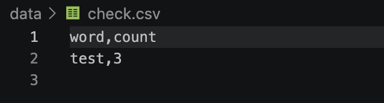
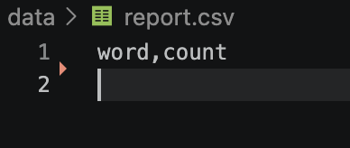
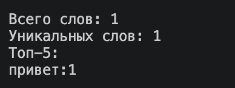
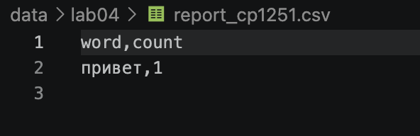

# Задание A — модуль src/lab04/io_txt_csv.py
## 1. read_text(path: str | Path, encoding: str = "utf-8") -> str
Открыть файл на чтение в указанной кодировке и вернуть содержимое как одну строку.
```
def read_text(path: str | Path, encoding: str = "utf-8") -> str:

    ''' Читает файл и возвращает его содержимое одной строкой
                path: путь к файлу
                encoding: кодировка файла, по умолчанию - utf-8
                    для другой нужно передать ее явно
                    например, read_text(...., encoding = "cp1251")
            FileNotFoundError: если файл не найден
            UnicodeDecodeError: при несовпадениии кодировки
            Returns:
                файл в виде строки
    '''
    
    
    return Path(path).read_text(encoding=encoding)
```

### 2. write_csv(rows: list[tuple | list], path: str | Path, header: tuple[str, ...] | None = None) -> None
Создать/перезаписать CSV с разделителем ,
```
def write_csv(rows: list[tuple | list], path: str | Path, header: tuple[str, ...] | None = None) -> None:

    ''' Записывает частоты слов в CSV файл
            rows: список данных строк
            path: путь к файлу
            header: заголовок
        ValueError: если строки разной длинны
    '''


    if rows:
        width = len(rows[0])
        for i in rows:
            if len(i) != width:
                raise ValueError("Разные длины строк")
    with Path(path).open("w", newline="", encoding="utf-8") as f:
        w = csv.writer(f)
        if header is not None:
            w.writerow(header)
        for i in rows:
            w.writerow(i)
```

### mini-test:
```
txt = read_text("data/input.txt")
write_csv([("word","count"),("test",3)], "data/check.csv")
```



# Задание B — скрипт src/lab04/text_report.py
Ввод данных
```
parser = argparse.ArgumentParser()
parser.add_argument("--in", dest="inp", default="data/lab04/input.txt")
parser.add_argument("--out", default="data/report.csv")
parser.add_argument("--encoding", default="utf-8")
args = parser.parse_args()
```
###  Пример вызова:
```
python3 -m src.lab_4.text_report --in data/lab04/input.txt --out data/out.csv
```

```
text = read_text(args.inp, encoding=args.encoding)

norm = normalize(text)
tokens = tokenize(norm)
freq = count_freq(tokens)
top = top_n(freq, n=len(freq))

write_csv(top, args.out, header=("word", "count"))
print()
if norm:
    print("Всего слов:", len(tokens))
    print("Уникальных слов:", len(freq))
    print("Топ-5:")
    ans = 0
    for i, j in top:
        print(i, ':', j, sep = '')
        ans += 1
        if ans == 5:
            break
    print()
```
# Тест-кейсы
## A. Один файл
### Вход (data/lab04/input.txt):
```
Привет, мир! Привет!!! Привееееееееет!! Как дела?
```
### Вывод в консоль:

### Вывод в report.csv:


## B Пустой файл

## C Кодировка cp1251
### Ввод: 
```
python3 -m src.lab_4.text_report --in data/lab04/input_cp1251.txt --encoding cp1251 --out data/lab04/report_cp1251.csv
```
### Вывод в консоль:


### Вывод в report.csv:
