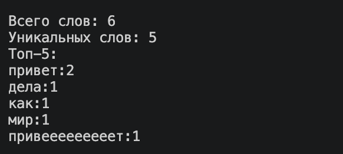
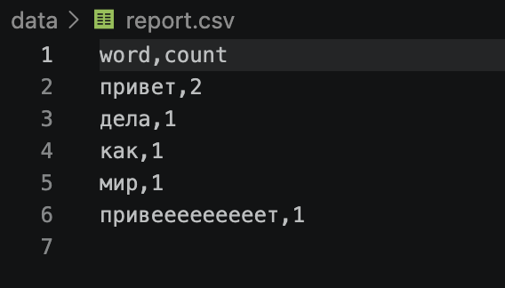

# Задание A — модуль src/lab04/io_txt_csv.py
## 1. read_text(path: str | Path, encoding: str = "utf-8") -> str
### Открыть файл на чтение в указанной кодировке и вернуть содержимое как одну строку.
### Вход (data/lab04/input.txt):
```
Привет, мир! Привет!!! Привееееееееет!! Как дела?
```
### Вывод в консоль:

### Вывод в report.csv


