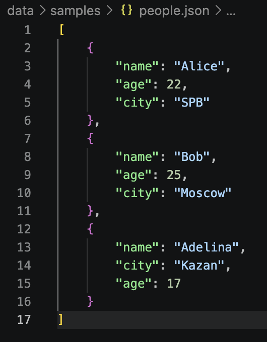
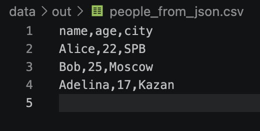
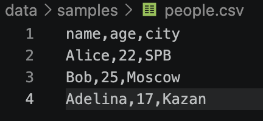
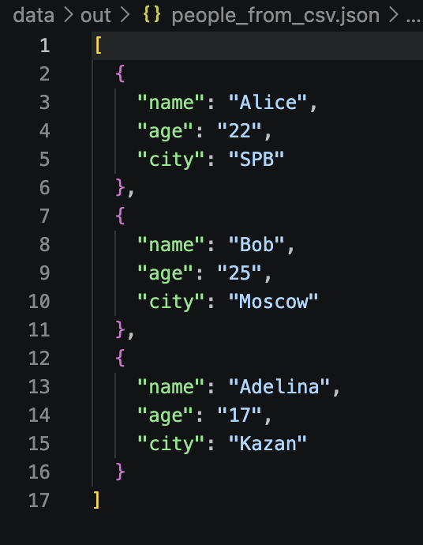
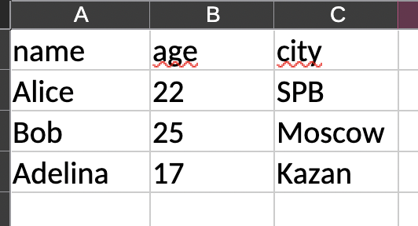
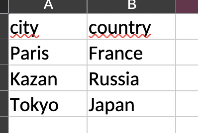

# Лабораторная работа 5 — JSON и конвертации

## Задание A — JSON ↔ CSV

### 1. json_to_csv(json_path, csv_path)

Функция преобразует JSON-файл со списком словарей в CSV.

- Читает JSON в кодировке UTF-8.
- Формирует заголовки из ключей словарей.
- Если поле отсутствует, записывает пустую ячейку.
- Порядок столбцов определяется порядком появления ключей в словарях.
- Записывает данные в CSV с кодировкой UTF-8.

Пример запуска:

```bash
python3 -c "from src.lab_5.json_csv import json_to_csv; json_to_csv('data/samples/people.json', 'data/out/people_from_json.csv')"
```

#### Входные данные:<br>
<br>
#### Результат выполнения:<br>
<br>

#### Обработка ошибок

- `ValueError` — входной файл имеет неправильное расширение (не `.json`), выходной файл имеет неправильное расширение (не `.csv`), JSON пустой или содержит данные неправильной структуры.
- `FileNotFoundError` — входной файл не найден.


### 2. csv_to_json(csv_path, json_path)

Функция преобразует CSV-файл в JSON — список словарей.

- Первая строка CSV используется как заголовок.
- Каждая следующая строка преобразуется в словарь.
- Значения сохраняются в виде строк.
- JSON записывается с параметрами `ensure_ascii=False` и `indent=2`.
- Проверяется наличие заголовка и соответствие количества значений количеству столбцов.

Пример запуска:

```bash
python3 -c "from src.lab_5.json_csv import csv_to_json; csv_to_json('data/samples/people.csv', 'data/out/people_from_csv.json')"
```

#### Входные данные:<br>
<br>
#### Результат выполнения:<br>
<br>

#### Обработка ошибок

- `ValueError` — входной файл имеет неправильное расширение (не `.csv`), выходной файл имеет неправильное расширение (не `.json`), CSV пустой, не содержит заголовка или строка содержит неправильное количество значений.
- `FileNotFoundError` — входной файл не найден.

## Задание B — CSV → XLSX

### csv_to_xlsx(csv_path, xlsx_path)

Функция преобразует CSV-файл в Excel формата XLSX с помощью библиотеки `openpyxl`.

- Первая строка CSV становится заголовком таблицы.
- Данные записываются на лист `Sheet1`.
- Ширина столбцов автоматически рассчитывается по длине текста.
- Минимальная ширина столбца — 8 символов.
- Проверяются расширения файлов, наличие входного файла и корректность CSV.

Пример запуска:

```bash
python3 -c "from src.lab_5.csv_xlsx import csv_to_xlsx; csv_to_xlsx('data/samples/people.csv', 'data/out/people.xlsx')"
```



```bash
python3 -c "from src.lab_5.csv_xlsx import csv_to_xlsx; csv_to_xlsx('data/samples/cities.csv', 'data/out/people.xlsx')"
```




#### Обработка ошибок

- `ValueError` — входной файл имеет неправильное расширение (не `.csv`), выходной файл имеет неправильное расширение (не `.xlsx`), CSV пустой, не содержит заголовка или строк с данными.
- `FileNotFoundError` — входной файл не найден.